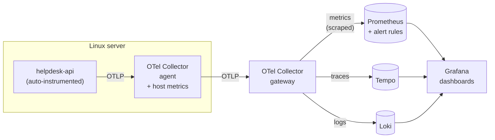

# helpdesk-observability

[](https://github.com/Zuzz001zu/helpdesk-observability/actions/workflows/ci.yml)

A small but complete observability platform built on **OpenTelemetry, Prometheus, Tempo,
Loki and Grafana**, and the onboarding of one real application into it:
[helpdesk-api](https://github.com/Zuzz001zu/helpdesk-api), a FastAPI service, instrumented
**without changing its code**.

It reproduces what a migration to OpenTelemetry looks like at the scale of one service:
an agent on every Linux server, a central gateway, dashboards that work for any service,
alert rules with unit tests, an installation script for the agent and an onboarding
checklist that can be repeated for the next application.

## Architecture



| Component | Role | Configuration |
|---|---|---|
| helpdesk-api | the application, built from its own repository plus the OpenTelemetry packages | [`app/`](app) |
| Collector agent | one per server: receives OTLP from local apps, collects CPU/memory/disk/network, adds host attributes | [`otel/agent.yaml`](otel/agent.yaml) |
| Collector gateway | central: batching, memory limits, routing metrics to Prometheus, traces to Tempo, logs to Loki | [`otel/gateway.yaml`](otel/gateway.yaml) |
| Prometheus | metrics storage, recording rules, alerts | [`prometheus/`](prometheus) |
| Tempo | traces | [`tempo/tempo.yaml`](tempo/tempo.yaml) |
| Loki | logs, received over OTLP, with the trace id of each request | [`loki/loki.yaml`](loki/loki.yaml) |
| Grafana | three provisioned dashboards, data sources as code | [`grafana/`](grafana) |

## Quick start

Requires Docker with Compose.

```bash
cp .env.example .env
docker compose up -d --build
python3 scripts/generate_traffic.py --duration 120     # realistic traffic, including 404/409/422
bash scripts/smoke-test.sh                             # checks that every signal arrived
```

| | |
|---|---|
| Grafana | http://localhost:3000 (anonymous read access; `admin` / `admin` to edit) |
| Prometheus | http://localhost:9090 (alerts: http://localhost:9090/alerts) |
| API | http://localhost:8000/docs |

## Dashboards

All dashboards use the OpenTelemetry semantic conventions, so they work for every
onboarded service, not only this one.

- **HTTP service overview**: requests per second, 5xx and 4xx ratios, latency percentiles,
  traffic and p95 per route, slowest routes, recent traces with errors (from Tempo),
  requests in progress, database connection pool, log volume by severity and the logs themselves.
- **Linux hosts**: CPU, memory, load, disk usage per mount point, network traffic.
- **Telemetry pipeline**: the collectors themselves: data received vs sent, export failures,
  queue usage. When this dashboard is wrong, all the others are.

## Alerts

Defined in [`prometheus/rules/helpdesk.yml`](prometheus/rules/helpdesk.yml), each with a
runbook entry in [`docs/alerts.md`](docs/alerts.md), and **unit-tested with `promtool`**
([`prometheus/tests/helpdesk.test.yml`](prometheus/tests/helpdesk.test.yml)).

| Alert | Condition | Severity |
|---|---|---|
| HighErrorRate | > 5 % of requests are 5xx for 5 min (only with real traffic) | critical |
| HighLatency | p95 > 500 ms for 10 min | warning |
| TelemetryPipelineDown | a collector cannot be scraped for 2 min | critical |
| CollectorExportFailing | a collector keeps failing to export data | warning |
| HostMemoryHigh | > 90 % memory used for 10 min | warning |
| HostDiskAlmostFull | a writable file system > 85 % full for 15 min | warning |

The tests also cover the cases that should *not* alert: 4xx responses, services with
almost no traffic, read-only mounts that are full by design.

```bash
promtool test rules prometheus/tests/helpdesk.test.yml
```

## Onboarding the next application

[`docs/onboarding.md`](docs/onboarding.md) is the checklist used for each application:
what to ask the owning team, naming rules for `service.name`, how to choose between automatic
instrumentation, scraping an existing Prometheus endpoint or reading log files, the
verification queries and the definition of done.

## Agent on a Linux server

```bash
sudo bash scripts/install-otel-agent.sh --gateway otel-gateway.example.org:4317 --environment production
```

The script downloads the collector from the official releases and **verifies its checksum**,
creates a system user, installs the same `agent.yaml` as the demo, **validates the
configuration before restarting** the service and installs a hardened systemd unit
(`NoNewPrivileges`, `ProtectSystem`, memory limit). Running it again only changes what
changed. `--dry-run` shows every step without changing anything.

CI runs it on a real Ubuntu machine and checks that the service is up and healthy.

## Design notes

- **Agent and gateway.** Applications only know `localhost:4317`. Where the data goes,
  how it is batched and which backend receives it is decided centrally, so backends can
  change without touching a thousand applications.
- **No code change in the application.** `opentelemetry-instrument` wraps the normal start
  command; everything else is environment variables ([`app/Dockerfile`](app/Dockerfile)).
- **Stable metric names.** `OTEL_SEMCONV_STABILITY_OPT_IN=http` gives
  `http_server_request_duration_seconds` with `http_route` and `http_response_status_code`,
  the names the dashboards and alerts rely on.
- **Labels kept small.** Resource attributes become Prometheus labels; SDK attributes that
  are the same on every series are dropped in the gateway, health checks are not traced.
- **Signals are linked.** Every log line keeps the `trace_id` of its request: from a log line
  Grafana opens the trace in Tempo, and from a span it opens the matching log lines in Loki.
- **Collectors watch themselves.** Their internal metrics are scraped, and a pipeline that
  stops sending data raises an alert instead of silently producing empty dashboards.

## CI

| Job | What it checks |
|---|---|
| lint | shellcheck, Python syntax, dashboard JSON, Compose file |
| validate | `otelcol validate` on both collector configs, `promtool check config`, alert rule unit tests |
| install-script | dry run, real installation with systemd, health check, idempotent second run |
| integration | starts the whole stack, generates traffic, runs the smoke test, takes screenshots of the dashboards (artifact) |

## Versions

| | |
|---|---|
| OpenTelemetry Collector (contrib) | 0.135.0 |
| OpenTelemetry Python | SDK 1.44.0, instrumentation 0.65b0 |
| Prometheus | 3.5.0 (LTS) |
| Tempo | 2.8.1 |
| Loki | 3.5.3 |
| Grafana | 12.1.0 |

## Limits of this setup

It is a working model, not a production deployment: Tempo, Loki and Prometheus run as
single instances with local storage, and the collectors talk to each other without TLS. In
production the gateway would be behind a load balancer with TLS, and the long-term metric
storage would be decided with the platform team.

## Project structure

```text
app/              Dockerfile and OpenTelemetry packages for the helpdesk API
otel/             collector configurations (agent, gateway)
prometheus/       scrape config, recording and alert rules, rule tests
tempo/            Tempo configuration
loki/             Loki configuration
grafana/          data sources, dashboard provider, dashboards (JSON)
scripts/          agent installation, traffic generator, smoke test
docs/             onboarding checklist, alert runbook
```

## License

MIT
